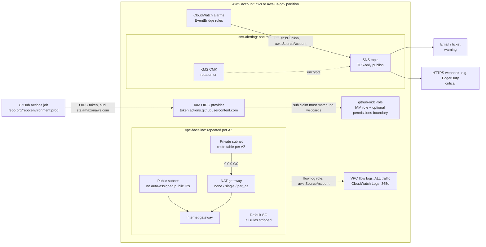

# terraform-aws-platform-modules

[](https://github.com/Krustytoe/terraform-aws-platform-modules/actions/workflows/terraform.yml) [](https://github.com/Krustytoe/terraform-aws-platform-modules/releases/latest) [](LICENSE)

Small, opinionated Terraform modules for standing up a secure AWS platform baseline. Built to work **unchanged in both AWS commercial and GovCloud** (partition-aware ARNs, no hard-coded `arn:aws:`), with defaults that line up with FedRAMP / NIST 800-53 expectations.

| Module | What it does | Key defaults |
|---|---|---|
| [`vpc-baseline`](modules/vpc-baseline) | Multi-AZ VPC with public/private tiers, NAT, and flow logs | Flow logs **on** (ALL traffic, 365d); default SG stripped; no auto-assigned public IPs; per-AZ private route tables |
| [`github-oidc-role`](modules/github-oidc-role) | IAM role GitHub Actions assumes via OIDC (no long-lived keys) | Rejects wildcard `sub` claims like `repo:*` / `repo:org/*`; optional permissions boundary |
| [`sns-alerting`](modules/sns-alerting) | KMS-encrypted SNS topic for CloudWatch / EventBridge alerts | Creates a rotating CMK that CloudWatch can actually publish through; denies non-TLS publish; webhook URLs treated as secrets |

## Architecture



## Usage

```hcl
module "vpc" {
  source = "git::https://github.com/Krustytoe/terraform-aws-platform-modules.git//modules/vpc-baseline?ref=v0.1.1" # x-release-please-version

  name             = "platform-prod"
  cidr_block       = "10.20.0.0/16"
  az_count         = 3
  nat_gateway_mode = "per_az"
}

module "deploy_role" {
  source = "git::https://github.com/Krustytoe/terraform-aws-platform-modules.git//modules/github-oidc-role?ref=v0.1.1" # x-release-please-version

  role_name      = "gha-platform-prod"
  subject_claims = ["repo:my-org/platform-infra:environment:prod"]
}

module "alerts_critical" {
  source = "git::https://github.com/Krustytoe/terraform-aws-platform-modules.git//modules/sns-alerting?ref=v0.1.1" # x-release-please-version

  name            = "platform-prod-critical"
  https_endpoints = [var.pagerduty_cloudwatch_url] # sensitive: pass via TF_VAR_, never commit
}
```

See [`examples/complete`](examples/complete) for all three wired together, including the warning/critical topic split.

## Design notes

- **Partition-aware.** ARNs are built from `aws_partition` or taken from resource attributes, so the same code plans in `aws` and `aws-us-gov`.
- **Confused-deputy guards.** Service-principal trust and resource policies are pinned with `aws:SourceAccount`.
- **Alert severity convention.** One topic per severity: `warning` = awareness (email/ticket), `critical` = service impact, page someone.
- **NAT trade-off is explicit.** `single` is cheap but has a single-AZ dependency; `per_az` costs about 1 NAT/AZ/month but survives an AZ loss; `none` is for isolated workloads that use VPC endpoints only.

## Testing

Every module ships offline unit tests using `terraform test` with a **mocked AWS provider**, so CI needs no cloud credentials.

```bash
cd modules/vpc-baseline
terraform init -backend=false
terraform test
```

CI ([`.github/workflows/terraform.yml`](.github/workflows/terraform.yml)) runs `fmt -check` → `validate` → `test` → `tflint` on every module and example.

## Requirements

| Name | Version |
|---|---|
| Terraform | >= 1.7 (for `mock_provider` in tests) |
| hashicorp/aws | >= 5.0 |

## License

MIT
